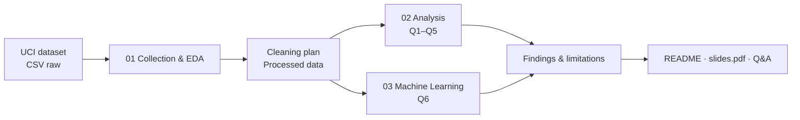

<div align="center">

# 🚗 In-Vehicle Coupon Acceptance

### Phân tích các yếu tố liên quan đến việc chấp nhận phiếu ưu đãi khi di chuyển

**ĐỒ ÁN CUỐI KỲ · CSC17104 – LẬP TRÌNH CHO KHOA HỌC DỮ LIỆU**


**Trần Nhật Dương · Nguyễn Mạnh Hà · Hoàng Công Lý**

[Nguồn dữ liệu UCI](https://archive.ics.uci.edu/dataset/603/in+vehicle+coupon+recommendation) · [Bộ câu hỏi](docs/research_questions.md) · [Tổng hợp Q1–Q5](notebooks/02_analysis.ipynb) · [Bắt đầu nhanh](#quick-start) · [Quy tắc làm việc](docs/CONTRIBUTING.md)

</div>

> [!NOTE]
> Toàn bộ 6 câu hỏi (**Q1–Q6**) và phần **Collection & EDA** đã được thực thi trên dữ liệu UCI #603 (`12.684` dòng × `26` cột) với `20` biểu đồ tại `reports/figures/`, `32` bảng tại `reports/tables/`, `20/20` unit tests pass và file trình bày `slides.pdf` tại thư mục gốc. Trước khi nộp cuối kỳ, các thành viên cần tự điền phần *Individual reflections* trong [02_analysis.ipynb](notebooks/02_analysis.ipynb).

---

<a id="overview"></a>
## 01. Tổng quan

Project tìm hiểu cách **bối cảnh hành trình, đặc điểm coupon, thói quen tiêu dùng và đặc điểm người trả lời** liên quan đến ý định chấp nhận coupon trong các tình huống lái xe giả định. Ngoài phân tích khám phá (EDA) và 5 câu hỏi thống kê có kiểm soát biến nhiễu (**Q1–Q5**), nhóm xây dựng mô hình phân loại để dự đoán nhãn `Y` (**Q6**).

**Đây là dữ liệu khảo sát về *ý định* chấp nhận**, không phải lịch sử coupon đã được sử dụng thực tế. Các kết quả quan sát là **mối liên hệ**, không tự động suy ra quan hệ nhân quả.

### Dataset chính

| Thuộc tính | Thông tin |
| :-- | :-- |
| Tên | In-Vehicle Coupon Recommendation |
| Kho dữ liệu | UCI Machine Learning Repository, Dataset ID `603` |
| Quy mô công bố | **12.684 dòng, 25 đặc trưng + 1 nhãn `Y`** (`Y = 1` chiếm **56,84%**) |
| Bài toán | Phân loại nhị phân: `Y = 1` chấp nhận, `Y = 0` không chấp nhận |
| Cách thu thập | Khảo sát các kịch bản lái xe trên Amazon Mechanical Turk |
| Chất lượng | `car` thiếu **99,15%**; 5 cột thói quen thiếu **0,84%–1,71%** (`matched_frequency` thiếu **1,29%**); `74` dòng trùng lặp hoàn toàn |
| Giấy phép dữ liệu | Creative Commons Attribution 4.0 (CC BY 4.0) |
| Trang nguồn | <https://archive.ics.uci.edu/dataset/603/in+vehicle+coupon+recommendation> |
| DOI | <https://doi.org/10.24432/C5GS4P> |

**Lưu ý về tên cột:** File CSV gốc dùng `passanger` (giữ nguyên tên cột gốc). `time` là **5 khung giờ trong ngày** (`7AM, 10AM, 2PM, 6PM, 10PM`), không có chuỗi ngày tháng. `age` chứa nhãn như `below21`, `50plus` và `income` là khoảng thu nhập nên giữ ở dạng phân loại có thứ tự. `toCoupon_GEQ5min` là cột hằng (`= 1` ở mọi dòng).

<a id="team"></a>
## 02. Thành viên & phân công

| Thành viên | Phân tích sở hữu | Công việc chính | MSSV |
| :-- | :-- | :-- | :-- |
| **Trần Nhật Dương** | **Q1 – Q2** | Collection, related work, hành trình/khoảng cách & thời hạn coupon; module dùng chung | `23120243` |
| **Nguyễn Mạnh Hà** | **Q3 – Q4** | EDA, cleaning plan, thói quen phù hợp & người đồng hành (common support) | `23120248` |
| **Hoàng Công Lý** | **Q5 – Q6 (ML)** | Phân khúc tuổi/thu nhập (cluster bootstrap) & mô hình ML dự đoán `Y` | `24120378` |

> **Mỗi người chịu trách nhiệm 2 câu hỏi** nhưng cần nắm rõ **toàn bộ code, phương pháp và kết quả** phục vụ phần hỏi đáp (10 phút).

<a id="questions"></a>
## 03. Sáu câu hỏi nghiên cứu & kết quả chính

| Mã | Người | Câu hỏi tóm tắt | Độ sâu | Kết luận chính từ số liệu thật |
| :-- | :-- | --- | --- | --- |
| **Q1** | Dương | Khoảng cách / hướng đến điểm dùng coupon liên quan đến `Y` ra sao khi xét mục đích và loại coupon? | D3, D4, D5 | Gần (`5–<15 min`: **61,42%**) > xa (`≥25 min`: **42,89%**, chênh **+18,53 pp**, CI `[15,64; 21,27]`). `Restaurant(<20)` sụt **42,74 pp** khi xa, còn `Carry out` giữ **73,21%**. Đi cùng hướng trong `Home` tăng **+17,40 pp** (dù gộp thô chỉ `+1,76 pp` do confounder `destination`). |
| **Q2** | Dương | Thời hạn `2h` vs `1d` liên quan đến `Y` thế nào theo khung giờ và loại coupon? | D2, D4, D5 | Tổng thể `1d` (**62,56%**) > `2h` (**49,60%**, **+12,96 pp**). Lúc `10AM` gộp thô đảo dấu (`-2,01 pp`) nhưng trong cả 5/5 coupon đều `1d > 2h` (nghịch lý Simpson). `Bar` lúc `10PM` nghiêng nhẹ về `2h` (`50,25%` vs `41,38%`). |
| **Q3** | Hà | Thói quen đến địa điểm có liên quan đến việc chấp nhận coupon tương ứng không? | D3, D4, D5, D6 | Nhóm thường xuyên (`1~3/4~8/gt8`) chấp nhận cao hơn ở cả 5 coupon: mạnh nhất ở `Bar` (**+39,58 pp**, CI `[35,09; 44,11]`) và `Coffee House` (**+31,41 pp**, CI `[28,37; 34,36]`). Chiều dương bền qua 4 biến thể ngưỡng/NaN. |
| **Q4** | Hà | Người đồng hành liên quan đến `Y` sau khi xét mục đích đi và loại coupon không? | D4, D5 | Gộp thô `Friend(s) − Alone` là **+14,76 pp**, nhưng sau chuẩn hóa `coupon × destination` thu hẹp còn **+1,33 pp** (CI `[-1,78; 4,48]`, chỉ `4/15` tầng đủ `n≥30`) do `Friend(s)` chỉ có ở `No Urgent Place` (`n=3.298`). Trong `Bar` vẫn chênh **+17,99 pp**. |
| **Q5** | Lý | Tuổi và thu nhập liên quan đến `Y` theo loại coupon ra sao khi kiểm soát thói quen? | D4, D5, D6 | `<26 − 50+` chênh **+9,7 pp**, giảm còn **+7,5 pp** (CI `[2,8; 12,4]`) sau chuẩn hóa thói quen (rõ ở `Bar`, `Coffee House`). Thu nhập `Thấp − Cao` chỉ **+4,4 pp** và mất ý nghĩa (**+3,8 pp**, CI `[-0,6; 7,8]`) khi cố định tuổi; nhóm `≥100k` nhận **57,8%**. |
| **Q6** | Lý | Có dự đoán được `Y` bằng thông tin trước khi đưa coupon không? | ML | Chia theo `567` người trả lời giả định (`453` train / `114` test): **Random Forest** đạt test **ROC-AUC = 0,782** (CI `[0,756; 0,808]`), **balanced accuracy = 0,705**, vượt xa `Dummy` (`0,500`) và `LogReg` (`0,726`). Hữu ích nhất để xếp hạng xác suất (`>0,7`: **84,4%** nhận). |

**Kiểm tra yêu cầu độ sâu:** Các câu non-ML bao phủ **D2, D3, D4, D5, D6** (`5/6` tiêu chí), chi tiết phương pháp và kết luận tổng hợp xem tại **[notebooks/02_analysis.ipynb](notebooks/02_analysis.ipynb)**.

<a id="workflow"></a>
## 04. Quy trình phân tích



<a id="structure"></a>
## 05. Cấu trúc repository

```text
in-vehicle-coupon-analysis/
├── .github/
│   ├── workflows/ci.yml                   # Kiểm tra cấu trúc và unit tests
│   └── PULL_REQUEST_TEMPLATE.md          # Mẫu review chung
├── .editorconfig
├── .gitattributes
├── .gitignore
├── README.md                              # Trang giới thiệu chính
├── environment.yml                       # Môi trường Conda
├── LLM_USAGE.md                          # Nhật ký sử dụng AI
├── slides.pdf                             # Slide thuyết trình cuối kỳ
├── data/
│   ├── README.md                          # Nguồn và cách tải dữ liệu
│   ├── raw/.gitkeep                       # CSV gốc (không commit dữ liệu lớn)
│   └── processed/.gitkeep                 # Bản dữ liệu đã xử lý
├── docs/
│   ├── CHECKLIST.md                       # Kiểm tra trước khi nộp
│   ├── CONTRIBUTING.md                    # Quy tắc cộng tác & Git
│   ├── PHAN_CONG_CHI_TIET_DUONG_HA_LY.md # Bảng phân công chi tiết nhóm
│   ├── assignment_requirements.md        # Tóm tắt tiêu chí đề môn học
│   ├── dataset_dictionary.md             # Từ điển các biến
│   ├── ha_analysis_protocol.md           # Quy ước kiểm tra phần Hà
│   ├── ha_handoff.md                     # Ghi chú bàn giao phần Hà
│   ├── research_questions.md             # Kế hoạch Q1–Q6
│   ├── related_work.md                   # Theo dõi phân tích công khai
│   ├── team_workflow.md                  # Cách ghép kết quả của 3 người
│   └── presentation_outline.md           # Dàn ý slide thuyết trình
├── notebooks/
│   ├── README.md
│   ├── 01_collection_exploration.ipynb   # Dương (Collection) + Hà (EDA)
│   ├── 02_analysis.ipynb                  # Tổng hợp Q1–Q5 & reflections
│   ├── 02A_duong_q1_q2.ipynb             # Dương – Q1 & Q2
│   ├── 02B_ha_q3_q4.ipynb                # Hà – Q3 & Q4
│   ├── 02C_ly_q5.ipynb                   # Lý – Q5
│   └── 03_ml_question.ipynb              # Lý – Q6 (ML)
├── src/coupon_project/
│   ├── __init__.py
│   ├── analysis.py                       # Hàm EDA, Q3 & Q4
│   ├── config.py
│   ├── data_io.py
│   ├── journey.py                        # Hàm D2/D3/D4/D5 cho Q1 & Q2
│   ├── metrics.py                        # Thống kê nhóm, bootstrap 95% CI (Q1–Q5)
│   ├── plotting.py                       # Hàm vẽ heatmap & grouped bar CI
│   └── quality.py
├── scripts/
│   ├── download_data.py                  # Tải dữ liệu chính thức từ UCI
│   ├── check_project.py                  # Kiểm tra cấu trúc & dữ liệu
│   └── run_ha_notebooks.py               # Chạy lại phần EDA & Q3–Q4
├── tests/                                 # Unit tests (20 tests)
├── reports/
│   ├── figures/                           # 20 biểu đồ sau phân tích
│   └── tables/                            # 32 bảng kết quả (gitignored CSV)
└── presentation/
    ├── slides.html                        # Nguồn HTML slide tổng hợp (xuất slides.pdf)
    ├── ha_slides.md                       # Nháp slide phần Hà
    └── ha_speaker_notes.md                # Ghi chú thuyết trình phần Hà
```

<a id="quick-start"></a>
## 06. Cài đặt & chạy (Quick start)

**Yêu cầu:** Git, Conda/Miniconda và kết nối Internet để tải dữ liệu lần đầu. Chạy lệnh tại **thư mục gốc** project.

```bash
# 1. Clone repository
git clone https://github.com/TrNhDuong/in-vehicle-coupon-analysis.git
cd in-vehicle-coupon-analysis

# 2. Tạo môi trường và kích hoạt
conda env create -f environment.yml
conda activate csc17104-coupon

# 3. Tải CSV gốc từ UCI (chỉ tải khi chưa có)
python scripts/download_data.py

# 4. Kiểm tra cấu trúc & unit tests
python scripts/check_project.py
python -m pytest -q

# 5. Mở Jupyter
jupyter lab
```

Thứ tự chạy notebook: `01_collection_exploration.ipynb` → `02A_duong_q1_q2.ipynb` / `02B_ha_q3_q4.ipynb` / `02C_ly_q5.ipynb` → `03_ml_question.ipynb` → `02_analysis.ipynb`. (Hoặc chạy nhanh 2 notebook phần Hà bằng `python scripts/run_ha_notebooks.py`.)

### Nếu không tải được qua script

1. Vào [trang UCI Dataset 603](https://archive.ics.uci.edu/dataset/603/in+vehicle+coupon+recommendation).
2. Tải và đặt file `in-vehicle-coupon-recommendation.csv` trong `data/raw/`.
3. Chạy lại `python scripts/check_project.py`.

<a id="ml-plan"></a>
## 07. Kế hoạch & kết quả Machine Learning (Q6)

| Thành phần | Triển khai thực tế trong `03_ml_question.ipynb` |
| :-- | :-- |
| Target & Features | `Y` (0/1); giữ **22** đặc trưng biết trước lúc hiển thị, loại `toCoupon_GEQ5min`, `direction_opp`, `car`, `Y` |
| Split & CV | Group split `80/20` theo `567` `respondent_id` giả định (`453` train / `114` test); `StratifiedGroupKFold(n_splits=5)` |
| Baseline & Models | `DummyClassifier(most_frequent)` (`ROC-AUC = 0,500`) · `LogisticRegression` (`0,726`) · **`RandomForestClassifier`** (`0,782`) |
| Preprocessing | `ColumnTransformer` (`SimpleImputer` + `OneHotEncoder(handle_unknown='ignore')`) trong `Pipeline`, fit chỉ trên train |
| Tuning & Test once | `GridSearchCV` tối ưu ROC-AUC trên train; chấm tập test đúng một lần + cluster bootstrap CI 95% |
| Error & interpretation | Accuracy **72,3%**, Bal. Acc. **0,705**, F1 **0,775**; `Carry out` FPR **90,5%**, `Bar` FNR **53,0%**; `coupon` dẫn đầu permutation importance |

<a id="references"></a>
## 08. Nguồn dữ liệu, tài liệu và liêm chính học thuật

- UCI ML Repository: [In-Vehicle Coupon Recommendation](https://archive.ics.uci.edu/dataset/603/in+vehicle+coupon+recommendation) — Dataset ID 603; DOI [10.24432/C5GS4P](https://doi.org/10.24432/C5GS4P); **CC BY 4.0**.
- Nghiên cứu gốc: Wang, T., Rudin, C., Doshi-Velez, F., Liu, Y., Klampfl, E., & MacNeille, P. (2017). *A Bayesian framework for learning rule sets for interpretable classification*. *Journal of Machine Learning Research*, 18(1), 2357–2393.
- Đối chiếu phân tích công khai: [docs/related_work.md](docs/related_work.md).
- Đề chính thức môn **CSC17104 – Programming for Data Science**.

> [!CAUTION]
> Theo đề, AI/LLM chỉ được dùng **như công cụ học tập**; **không dùng để làm thay phần phân tích, kết luận hoặc reflection**. Mọi lần sử dụng đáng kể đều được ghi tại [`LLM_USAGE.md`](LLM_USAGE.md). Mỗi thành viên cần giải thích được toàn bộ code đã nộp.

---

<div align="center">

**Built as a reproducible, collaborative academic data science project.**  
*CSC17104 · Trần Nhật Dương · Nguyễn Mạnh Hà · Hoàng Công Lý*

</div>
