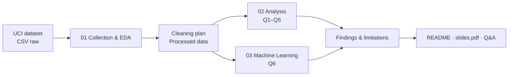

<div align="center">

# 🚗 In-Vehicle Coupon Acceptance

### Phân tích các yếu tố liên quan đến việc chấp nhận phiếu ưu đãi khi di chuyển

**ĐỒ ÁN CUỐI KỲ · CSC17104 – LẬP TRÌNH CHO KHOA HỌC DỮ LIỆU**


**Trần Nhật Dương · Nguyễn Mạnh Hà · Hoàng Công Lý**

[Nguồn dữ liệu UCI](https://archive.ics.uci.edu/dataset/603/in+vehicle+coupon+recommendation) · [Bộ câu hỏi](docs/research_questions.md) · [Bắt đầu nhanh](#quick-start) · [Quy tắc làm việc](CONTRIBUTING.md)

</div>

> [!IMPORTANT]
> Đây là **bộ khung đồ án (starter repository)**, chưa phải sản phẩm phân tích hoàn chỉnh. Các notebook có mục lục, câu hỏi và vị trí để nhóm tự viết code, tính toán và kết luận. **Chưa có kết quả, biểu đồ, mô hình đã huấn luyện hay slide cuối kỳ.** Không sử dụng số liệu giả làm kết quả thực nghiệm.

---

<a id="overview"></a>
## 01. Tổng quan

Project tìm hiểu cách **bối cảnh hành trình, đặc điểm coupon, thói quen tiêu dùng và đặc điểm người trả lời** liên quan đến ý định chấp nhận coupon trong các tình huống lái xe giả định. Ngoài phân tích khám phá (EDA), nhóm sẽ xây dựng mô hình phân loại để dự đoán nhãn `Y`.

**Đây là dữ liệu khảo sát về *ý định* chấp nhận**, không phải lịch sử coupon đã được sử dụng thực tế. Các kết quả quan sát là **mối liên hệ**, không tự động suy ra quan hệ nhân quả.

### Dataset chính

| Thuộc tính | Thông tin |
| :-- | :-- |
| Tên | In-Vehicle Coupon Recommendation |
| Kho dữ liệu | UCI Machine Learning Repository, Dataset ID `603` |
| Quy mô công bố | **12.684 dòng, 25 đặc trưng + 1 nhãn `Y`** |
| Bài toán | Phân loại nhị phân: `Y = 1` chấp nhận, `Y = 0` không chấp nhận |
| Cách thu thập | Khảo sát các kịch bản lái xe trên Amazon Mechanical Turk |
| Chất lượng | Có dữ liệu thiếu; cần kiểm tra trong EDA |
| Giấy phép dữ liệu | Creative Commons Attribution 4.0 (CC BY 4.0) |
| Trang nguồn | <https://archive.ics.uci.edu/dataset/603/in+vehicle+coupon+recommendation> |
| DOI | <https://doi.org/10.24432/C5GS4P> |

**Lưu ý về tên cột:** File CSV gốc dùng `passanger` (sai chính tả tiếng Anh nhưng là tên cột thực tế), không nên tự đổi tên mà không ghi vào notebook. `time` là **thời điểm trong ngày**, không có thông tin chuỗi ngày tháng. `age` chứa cả nhãn như `below21`, `50plus` nên không ép trực tiếp toàn bộ thành số nguyên.

<a id="team"></a>
## 02. Thành viên & phân công

| Thành viên | Phân tích sở hữu | Công việc chính | MSSV |
| :-- | :-- | :-- | :-- |
| **Trần Nhật Dương** | **Q1 – Q2** | Bối cảnh hành trình, khoảng cách, thời hạn coupon; hỗ trợ data collection | `BỔ SUNG` |
| **Nguyễn Mạnh Hà** | **Q3 – Q4** | Thói quen, mức độ phù hợp coupon, người đồng hành; hỗ trợ kiểm tra dữ liệu | `BỔ SUNG` |
| **Hoàng Công Lý** | **Q5 – Q6 (ML)** | Nhân khẩu học và mô hình dự đoán; hỗ trợ tái lập pipeline | `BỔ SUNG` |

> **Mỗi người chịu trách nhiệm 2 câu hỏi** nhưng phải hiểu được **toàn bộ code, phương pháp và kết quả** vì giảng viên có thể hỏi bất kỳ phần nào. Phân công có thể thay đổi nếu nhóm thống nhất và cập nhật README/Git history.

<a id="questions"></a>
## 03. Sáu câu hỏi nghiên cứu

| Mã | Người | Câu hỏi tóm tắt | Mức độ sâu đề xuất |
| :-- | :-- | :-- | :-- |
| **Q1** | Dương | Khoảng cách / hướng đến địa điểm sử dụng coupon liên quan đến tỷ lệ chấp nhận ra sao khi xét mục đích và loại coupon? | D3, D4, D5 |
| **Q2** | Dương | Thời hạn `2h` so với `1d` liên quan đến tỷ lệ chấp nhận thế nào theo thời điểm trong ngày / loại coupon? | D2, D4, D5 |
| **Q3** | Hà | Thói quen đến địa điểm có liên quan đến việc chấp nhận coupon tương ứng không? | D3, D4, D5, D6 |
| **Q4** | Hà | Người đồng hành có liên quan đến tỷ lệ chấp nhận sau khi xét mục đích đi và loại coupon không? | D4, D5 |
| **Q5** | Lý | Tuổi và thu nhập liên quan đến việc chấp nhận từng loại coupon ra sao, sau khi xét thói quen? | D4, D5, D6 |
| **Q6** | Lý | Có dự đoán được `Y` bằng thông tin biết trước khi đưa coupon không? | ML – baseline + ≥ 2 models |

**Kiểm tra yêu cầu độ sâu:** Câu non-ML có ít nhất **2 tiêu chí mỗi câu**; toàn bộ câu non-ML đề xuất bao phủ **D2, D3, D4, D5, D6** (5/6, cần được *thực hiện và chứng minh*, không chỉ ghi nhãn). Không bắt buộc sử dụng D1 nếu đã đủ tối thiểu 4 tiêu chí. Chi tiết phương pháp, biến và biểu đồ: **[docs/research_questions.md](docs/research_questions.md)**.

<a id="workflow"></a>
## 04. Quy trình phân tích



1. **Collection:** dẫn nguồn đầy đủ (tác giả, phạm vi, phương thức, giấy phép và hạn chế).
2. **Exploration:** rà soát giá trị thiếu, trùng lặp, kiểu dữ liệu, nhãn bất nhất, outlier và quan hệ biến.
3. **Question design:** mỗi câu có mục tiêu, lý do quan trọng và ít nhất 2 tiêu chí D1–D6 nếu non-ML.
4. **Analysis:** mô tả tiền xử lý trước khi chạy, ghi số dòng trước/sau từng thay đổi, phương pháp và lý do chọn.
5. **Results:** **ít nhất 2 biểu đồ có nhãn rõ ràng cho mỗi câu hỏi**, kèm số liệu, ý nghĩa và giới hạn.
6. **Reflection:** 3–5 kết quả chính của nhóm; hạn chế; hướng mở rộng; reflection **cá nhân** và log sử dụng LLM.

<a id="structure"></a>
## 05. Cấu trúc repository

```text
in-vehicle-coupon-analysis/
├── .github/
│   ├── workflows/ci.yml                   # Kiểm tra cấu trúc và unit tests
│   └── PULL_REQUEST_TEMPLATE.md          # Mẫu review chung
├── .editorconfig
├── .gitattributes
├── .gitignore
├── README.md                              # Trang giới thiệu chính
├── environment.yml                       # Môi trường Conda
├── CONTRIBUTING.md                       # Quy tắc cộng tác & Git
├── LLM_USAGE.md                          # Nhật ký sử dụng AI (mẫu)
├── CHECKLIST.md                          # Kiểm tra trước khi nộp
├── data/
│   ├── README.md                          # Nguồn và cách tải dữ liệu
│   ├── raw/.gitkeep                       # CSV gốc (không commit dữ liệu lớn)
│   └── processed/.gitkeep                 # Bản dữ liệu đã xử lý
├── docs/
│   ├── assignment_requirements.md        # Tóm tắt tiêu chí đề môn học
│   ├── dataset_dictionary.md             # Từ điển các biến
│   ├── research_questions.md             # Kế hoạch Q1–Q6
│   ├── related_work.md                   # Theo dõi phân tích công khai
│   ├── team_workflow.md                  # Cách ghép kết quả của 3 người
│   └── presentation_outline.md           # Dàn ý slide thuyết trình
├── notebooks/
│   ├── README.md
│   ├── 01_collection_exploration.ipynb
│   ├── 02_analysis.ipynb                  # Trang tổng hợp/điều hướng Q1–Q5
│   ├── 02A_duong_q1_q2.ipynb
│   ├── 02B_ha_q3_q4.ipynb
│   ├── 02C_ly_q5.ipynb
│   └── 03_ml_question.ipynb               # Lý – Q6
├── src/coupon_project/                  # Tiện ích đọc/kiểm tra dữ liệu
│   ├── __init__.py
│   ├── config.py
│   ├── data_io.py
│   └── quality.py
├── scripts/
│   ├── download_data.py                  # Tải dữ liệu chính thức từ UCI
│   └── check_project.py                 # Kiểm tra chuẩn bị trước khi chạy
├── tests/                                 # Unit tests nhẹ cho tiện ích
├── reports/
│   ├── figures/.gitkeep                  # Biểu đồ sau phân tích
│   └── tables/.gitkeep                   # Bảng kết quả sau phân tích
└── presentation/.gitkeep                 # Nguồn slide làm việc, tuỳ chọn
```

> **Khi hoàn thành:** xuất file `slides.pdf` **ở thư mục gốc** đúng theo cấu trúc đề môn học (hiện chưa có vì nhóm chưa thuyết trình). Các file `.gitkeep` chỉ để Git theo dõi thư mục trống.

<a id="quick-start"></a>
## 06. Cài đặt & chạy (Quick start)

**Yêu cầu:** Git, Conda/Miniconda và kết nối Internet để tải dữ liệu lần đầu. Chạy lệnh tại **thư mục gốc** project.

```bash
# 1. Clone repository (thay YOUR-USERNAME bằng địa chỉ thực tế)
git clone https://github.com/YOUR-USERNAME/in-vehicle-coupon-analysis.git
cd in-vehicle-coupon-analysis

# 2. Tạo môi trường và kích hoạt
conda env create -f environment.yml
conda activate csc17104-coupon

# 3. Tải CSV gốc từ UCI (chỉ tải khi chưa có)
python scripts/download_data.py

# 4. Kiểm tra scaffold / tệp dữ liệu
python scripts/check_project.py

# 5. Mở Jupyter
jupyter lab
```

Mở và chạy theo thứ tự:

1. `notebooks/01_collection_exploration.ipynb`
2. `notebooks/02_analysis.ipynb` và các notebook Q1–Q5 tương ứng
3. `notebooks/03_ml_question.ipynb`
4. Hoàn thiện phát hiện chung, kiểm chứng số liệu và thuyết trình

Để kiểm tra tiện ích hỗ trợ: `python -m pytest -q`.

### Nếu không tải được qua script

1. Vào [trang UCI Dataset 603](https://archive.ics.uci.edu/dataset/603/in+vehicle+coupon+recommendation).
2. Tải file dữ liệu theo hướng dẫn trên trang, giải nén nếu cần.
3. Đặt file `in-vehicle-coupon-recommendation.csv` trong `data/raw/`.
4. Chạy lại `python scripts/check_project.py`.

Script có nguồn tải dự phòng; nếu UCI đổi đường dẫn thì tải thủ công qua trang gốc. Không commit dữ liệu lớn lên Git theo `.gitignore`.

<a id="ml-plan"></a>
## 07. Kế hoạch Machine Learning (Q6)

| Thành phần | Nguyên tắc triển khai |
| :-- | :-- |
| Target | `Y` – nhị phân 0/1 |
| Baseline | `DummyClassifier` |
| Model 1 | `LogisticRegression` |
| Model 2 | `RandomForestClassifier` |
| Preprocessing | `ColumnTransformer` + `Pipeline` (chỉ fit trên training) |
| Split | Xem xét đối tượng lặp; nếu không có ID, thảo luận giới hạn split và cân nhắc stratification |
| Tuning | Cross-validation trên tập train, **test chỉ đánh giá một lần** |
| Metrics | F1 / ROC-AUC / balanced accuracy (chọn và giải thích theo phân bố lớp) |
| Error & interpretation | Confusion matrix, kiểm tra nhóm sai nhiều, permutation importance |
| Leakage | Không dùng `Y` trong features, kiểm tra mọi cột có sẵn tại thời điểm dự đoán |

Kết quả nào cũng phải có **đánh giá trên test và giải thích bằng số liệu thật**. Không chọn mô hình tốt nhất bằng cách thử đi thử lại trên test.

<a id="references"></a>
## 08. Nguồn dữ liệu, tài liệu và liêm chính học thuật

- UCI ML Repository: [In-Vehicle Coupon Recommendation](https://archive.ics.uci.edu/dataset/603/in+vehicle+coupon+recommendation) — Dataset ID 603; DOI [10.24432/C5GS4P](https://doi.org/10.24432/C5GS4P); **CC BY 4.0**.
- Nghiên cứu liên quan: Wang, T., Rudin, C., Doshi-Velez, F., Liu, Y., Klampfl, E., & MacNeille, P. (2017). *A Bayesian framework for learning rule sets for interpretable classification*. *Journal of Machine Learning Research*, 18(1), 2357–2393.
- Các notebook/bài phân tích công khai có liên quan cần được **đối chiếu và ghi nguồn** trước khi nộp: [docs/related_work.md](docs/related_work.md).
- Đề chính thức môn **CSC17104 – Programming for Data Science**, tài liệu PDF giảng viên cung cấp cho lớp.

> [!CAUTION]
> Theo đề, AI/LLM chỉ được dùng **như công cụ học tập** để giải thích khái niệm, lỗi và thư viện; **không được để AI làm thay phần phân tích, kết luận hoặc reflection**. Mọi lần sử dụng đáng kể phải ghi vào [`LLM_USAGE.md`](LLM_USAGE.md). Mỗi thành viên phải giải thích được code đã nộp. Sao chép code/nội dung từ nguồn khác mà không trích dẫn là vi phạm học thuật.

---

<div align="center">

**Built as a reproducible, collaborative academic data science project.**  
*CSC17104 · Trần Nhật Dương · Nguyễn Mạnh Hà · Hoàng Công Lý*

</div>
