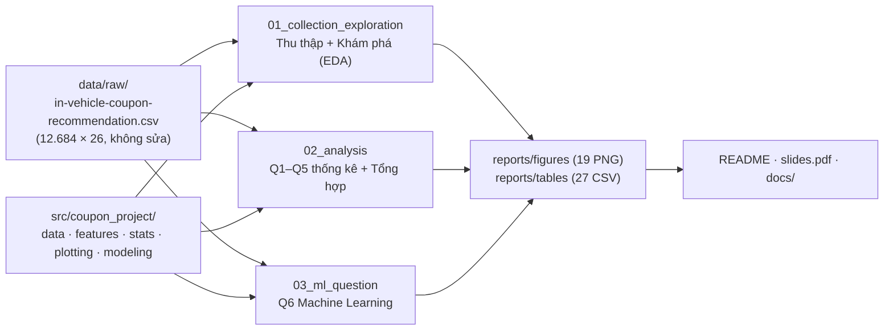

# Hướng dẫn hệ thống: luồng chạy, code và lý do thiết kế

Tài liệu dành cho **cả 3 thành viên**. Giảng viên chọn ai trình bày phần nào và có thể hỏi bất kỳ dòng code nào, nên mỗi người cần hiểu toàn bộ hệ thống, không chỉ phần mình viết.
Cách đọc nhanh: mục 1–3 để nắm bức tranh chung (10 phút); mục 4–7 khi cần giải thích một hàm hay một cell cụ thể; mục 8–9 trả lời câu hỏi "số này ở đâu ra, sao lại làm vậy?".
Phần lý thuyết và câu hỏi vấn đáp có đáp án nằm ở [`NGAN_HANG_VAN_DAP.md`](NGAN_HANG_VAN_DAP.md).

---

## 1. Bức tranh tổng thể



- **Mỗi notebook tự đọc lại CSV gốc** bằng `load_raw_data()`; không notebook nào dùng biến của notebook khác. Vì vậy chạy riêng notebook nào cũng được, miễn đã có CSV gốc.
- **Logic dùng chung nằm trong `src/coupon_project/`**: notebook chỉ gọi hàm và trình bày. Nhờ vậy cùng một cách tính CI hay chia dữ liệu được dùng nhất quán ở mọi câu và được kiểm thử bằng `pytest`.
- **`scripts/run_all.py`** chạy lần lượt: kiểm tra cấu trúc → 44 test → notebook 01 → 02 → 03, rồi kiểm tra notebook không có lỗi và CSV gốc không bị sửa (so SHA-256).

## 2. Cấu trúc thư mục

| Đường dẫn | Vai trò | Người phụ trách chính |
| --- | --- | --- |
| `data/raw/` | CSV gốc tải từ UCI (bị `.gitignore`, không commit) | — |
| `data/processed/analysis_ready.csv` | Bản dữ liệu đã kiểm tra + 2 cột dẫn xuất (chỉ để mô tả, không dùng cho ML) | Hà |
| `src/coupon_project/data.py` | Đường dẫn, đọc CSV, bảng thiếu dữ liệu, lưu bảng, log số dòng | Hà |
| `src/coupon_project/features.py` | Thứ tự danh mục, `travel_time_band`, `matched_frequency`, `respondent_id` | Hà |
| `src/coupon_project/stats.py` | Tỷ lệ, Wilson/bootstrap CI, contrasts, chuẩn hóa, pivot, bootstrap theo người | Dương (CI) + Lý (cluster) |
| `src/coupon_project/plotting.py` | Style, lưu hình, heatmap kèm `n`, cột kèm CI | Dương |
| `src/coupon_project/modeling.py` | Pipeline chống rò rỉ, bootstrap metric theo người, bảng lỗi | Lý |
| `notebooks/01…`, `02…`, `03…` | 3 Phase của đề | Dương + Hà / cả nhóm / Lý |
| `scripts/download_data.py` | Tải CSV từ UCI, kiểm tra SHA-256 | Dương |
| `scripts/check_project.py` | Kiểm tra đủ file, đọc thử CSV | Dương |
| `scripts/run_all.py` | Chạy toàn bộ pipeline bằng 1 lệnh | Dương |
| `tests/` | 44 unit test (pytest) | chung |
| `environment.yml`, `requirements.txt`, `pyproject.toml` | Môi trường ghim phiên bản; cấu hình gói | chung |
| `presentation/slides.html` → `slides.pdf` | Slide (nguồn HTML, xuất PDF bằng trình duyệt) | chung |
| `docs/` | Từ điển dữ liệu, câu hỏi, related work, API, kế hoạch, tài liệu này, ngân hàng vấn đáp, báo cáo rà soát | chung |

## 3. Chạy lại dự án từ đầu

```bash
conda env create -f environment.yml && conda activate csc17104-coupon   # hoặc: venv Python 3.11 + pip install -r requirements.txt
python -m pip install -e . --no-deps      # cài gói coupon_project ở chế độ "editable"
python scripts/download_data.py           # tải CSV về data/raw/ và so SHA-256
python scripts/run_all.py                 # ~3 phút: check → 44 test → 01 → 02 → 03
```

| Hiện tượng | Nguyên nhân | Cách xử lý |
| --- | --- | --- |
| Số liệu Q6 lệch ở chữ số thứ 3 | Khác phiên bản `scikit-learn` (bản ≤ 1.7 chia fold `StratifiedGroupKFold` khác) | Dùng đúng `environment.yml`/`requirements.txt` (sklearn 1.8.0) |
| `UnicodeEncodeError` khi chuyển hướng output ra file trên Windows | Console Windows mặc định cp1252 | Các script đã tự chuyển stdout sang UTF-8; với lệnh khác đặt `PYTHONIOENCODING=utf-8` |
| "An Application Control policy has blocked this file" | Windows Smart App Control chặn file `.exe`/`.pyd` chưa có uy tín | Gọi công cụ qua `python -m …`; dùng đúng phiên bản đã ghim |
| `FileNotFoundError: Chưa có dữ liệu` | Chưa tải CSV | `python scripts/download_data.py` |

---

## 4. Gói `coupon_project`: từng module, từng hàm

Phụ thuộc thật giữa các module: `plotting` → `data` (lấy `FIGURES_DIR`); `stats` → `features` (lấy `TIME_ORDER`, `EXPIRATION_ORDER`); `data`, `features`, `modeling` không phụ thuộc module nào khác trong gói. `modeling` import scikit-learn **bên trong hàm** để môi trường chỉ có pandas vẫn import được gói.

### 4.1. `data.py`
| Hàm / hằng | Làm gì | Vì sao |
| --- | --- | --- |
| `PROJECT_ROOT`, `RAW_CSV_PATH`, `FIGURES_DIR`, `TABLES_DIR` | Tự tìm thư mục gốc (thư mục chứa `pyproject.toml` và `src/`) rồi dựng đường dẫn | Notebook chạy từ thư mục nào cũng tìm đúng file |
| `REQUIRED_COLUMNS` | Đủ 26 cột của CSV gốc | Đọc nhầm file thì báo lỗi ngay (fail-fast) |
| `load_raw_data(path)` | `pd.read_csv` + kiểm tra đủ cột; **không** sửa/bỏ dòng nào | Giữ dữ liệu gốc nguyên vẹn |
| `row_count_log(before, after, action)` | Chuỗi "action: 12,684 -> 12,520 rows (delta -164)" | Đề yêu cầu ghi số dòng trước/sau mỗi bước lọc |
| `audit_row(...)` | Một dòng bảng kiểm kê (trước, sau, số bị loại, lý do) | Gom thành bảng `eda_row_audit` |
| `missing_table(df)` | Số ô thiếu và % thiếu từng cột, sắp giảm dần | Phase 1 – câu hỏi % thiếu |
| `target_is_binary(df)` | `Y` có đủ, chỉ gồm 0/1 không | Mọi tỷ lệ = trung bình của `Y` |
| `save_table(df, name)` | Lưu `reports/tables/{name}.csv` (UTF-8 có BOM để Excel đọc tiếng Việt), trả về đường dẫn | Trong notebook **không để `save_table(...)` là dòng cuối cell**, nếu không Jupyter sẽ in đường dẫn máy |

### 4.2. `features.py`
- **Hằng thứ tự**: `TRAVEL_BAND_ORDER`, `TIME_ORDER`, `EXPIRATION_ORDER`, `FREQUENCIES`, `AGE_ORDER`, `INCOME_ORDER`, `COUPONS`, `PASSENGERS`, `DESTINATIONS`. Dùng cho `pd.Categorical(..., ordered=True)` vì sắp chuỗi cho thứ tự sai (`"10AM" < "7AM"`).
- **`COUPON_FREQUENCY`**: ánh xạ loại coupon → cột thói quen tương ứng (`Coffee House` → `CoffeeHouse`, …).
- **`check_journey_flags(df)`**: đếm vi phạm `GEQ25=1 nhưng GEQ15=0`, kiểm tra `GEQ5` luôn 1 và `direction_same + direction_opp = 1`.
- **`add_travel_time_band(df)` (D3)**: trả về **bản sao** có cột `travel_time_band`:

  | `toCoupon_GEQ15min` | `toCoupon_GEQ25min` | `travel_time_band` |
  | --- | --- | --- |
  | 0 | 0 | `5-<15 min` |
  | 1 | 0 | `15-<25 min` |
  | 1 | 1 | `>=25 min` |

  Nếu có dòng vô lý (`GEQ25=1, GEQ15=0`) thì báo lỗi thay vì gán bừa.
- **`matched_frequency(df)` (D3)**: với mỗi dòng lấy giá trị ở **đúng** cột thói quen của loại coupon dòng đó; ô thiếu giữ nguyên `<NA>`; báo lỗi nếu coupon thiếu/lạ hoặc tần suất ngoài 5 mức chuẩn.
- **`build_respondent_id(df, profile_cols)`**: `groupby(profile_cols, dropna=False, sort=False).ngroup()` — các dòng có cùng toàn bộ hồ sơ (+ thói quen) nhận cùng một số. `dropna=False`: NaN được coi là một giá trị (dòng thiếu thói quen không bị mất ID). Kết quả: 567 ID; 489 ID (86,2%) có đúng 22 dòng; một số ID có 44/66/110 dòng là vài người hồ sơ giống hệt bị gộp.

### 4.3. `stats.py`
**Quy ước đơn vị:** tỷ lệ theo `%`, chênh lệch theo **điểm phần trăm (pp)**; `MIN_N = 30`; seed mặc định 42; `N_BOOT = 2000`.

| Hàm | Làm gì (ngắn gọn) |
| --- | --- |
| `validate_binary(values)` | Ép về mảng số, báo lỗi nếu có NaN hoặc giá trị khác 0/1 |
| `_plain`, `rng_for(key, seed)` | Băm SHA-256 của `str(key)` thành seed riêng cho từng phép so sánh/tầng → kết quả không phụ thuộc thứ tự gọi hàm; `_plain` đổi số kiểu numpy sang số Python để seed giống nhau trên mọi phiên bản numpy/pandas |
| `wilson_ci(k, n)` | CI 95% Wilson cho một tỷ lệ (không vượt [0; 100], tốt hơn công thức Wald khi n nhỏ hoặc p gần 0/1) |
| `bootstrap_rate_ci(values)` | CI bootstrap percentile cho một tỷ lệ; với biến 0/1, rút lại dòng tương đương rút `Binomial(n, p̂)` nên code rút nhị thức cho nhanh |
| `bootstrap_diff_ci(a, b)` | Chênh `A − B` (pp) + CI: rút độc lập hai nhị thức rồi trừ |
| `rate_table(df, cols, ci_method)` | Bảng `n`, `accepted`, `rate_pct`, CI, `small_n` cho từng nhóm của `cols` |
| `contrasts(df, strata_cols, exposure, a, b, key=...)` | Trong **mỗi tầng**, tính `A − B` + CI; `status` = `ok` / `small_n` / `no_common_support` (tầng thiếu hẳn một nhóm thì không tính) |
| `standardized_contrast(strata_df)` | Trung bình có trọng số các chênh lệch tầng đủ mẫu (`n ≥ 30` ở cả 2 nhóm): `w_s = (n_A,s + n_B,s) / Σ(n_A + n_B)`; `coverage` = tỷ lệ mẫu thuộc các tầng được dùng. Kết quả là chênh lệch **trong các tầng common support**, không phải toàn mẫu |
| `pivot_expiration(df)` (D2) | `pivot_table` tỷ lệ và số dòng theo `time × expiration`, cột `diff_1d_minus_2h_pp`, rồi `melt` sang dạng dài |
| `_cluster_bootstrap(...)` | Lõi của bootstrap theo người (xem bên dưới) |
| `cluster_rates_ci(data, group_col, strata_cols)` | Tỷ lệ (đã chuẩn hóa nếu có tầng) của mọi nhóm + CI theo người |
| `cluster_diff_ci(data, group_col, a, b, strata_cols, unit)` | Chênh `A − B` (đã chuẩn hóa) + CI theo người; `unit="row"` là bản so sánh rút theo dòng |

**Thuật toán `_cluster_bootstrap` (chuẩn hóa trực tiếp + bootstrap theo người)**
1. Gán mỗi dòng vào một ô `(nhóm, tầng)`, ví dụ (`<26`, `Bar × Thường`).
2. Với một bộ trọng số dòng `w`: tỷ lệ mỗi ô = `Σ w·Y / Σ w`; tỷ trọng mỗi tầng = `Σ w` của tầng / `Σ w` toàn bộ; **tỷ lệ chuẩn hóa** của nhóm = `Σ_tầng tỷ lệ ô × tỷ trọng tầng` — tức tỷ lệ của nhóm *nếu nhóm đó có cùng cơ cấu tầng như toàn mẫu*.
3. Điểm ước lượng: `w = 1` cho mọi dòng.
4. Mỗi lần bootstrap: rút lại **người** có hoàn lại (`rng.multinomial`), người được rút `k` lần thì mọi dòng của họ có `w = k`; tính lại bước 2. Lặp 2.000 lần, lấy phân vị 2,5% và 97,5%. Lần rút có ô rỗng cho `NaN` và bị loại (đếm trong `empty_strata_draws`).
5. Vì sao theo người: một người trả lời ~22 tình huống, các dòng của cùng người không độc lập; rút theo dòng làm CI hẹp giả tạo (Q5: hẹp hơn ~1,8 lần).

### 4.4. `plotting.py`
- `set_style()`: cỡ chữ, độ phân giải, bỏ viền trên/phải.
- `save_figure(fig, name)`: lưu `reports/figures/{name}.png` nền trắng, dpi 160.
- `plot_heatmap(rate, count, ...)`: mỗi ô ghi giá trị và `n`; ô `n = 0` ghi "No data"; ô `n < min_n_warn` gắn `*`; `signed=True` cho bảng chênh lệch (thang đỏ–xanh đối xứng quanh 0); truyền `ax=` để vẽ nhiều heatmap trong một hình; trả về `(fig, ax, im)`.
- `plot_bars_ci(summary_df, ...)`: cột nhóm + thanh CI 95% + nhãn `%` và `n`, nhận đúng bảng của `rate_table`.

### 4.5. `modeling.py`
- `build_pipeline(estimator, cat_cols, bin_cols)`: `ColumnTransformer` gồm nhánh phân loại (`SimpleImputer(strategy="constant", fill_value="missing")` → `OneHotEncoder(handle_unknown="ignore")`) và nhánh 0/1 giữ nguyên, nối với mô hình trong một `Pipeline`. Khi `fit`, imputer/encoder chỉ học từ dữ liệu train của lần fit đó → không rò rỉ.
- `cluster_bootstrap_metric(metric_fn, y, scores, groups)`: rút lại người của tập test (1.000 lần), truyền số lần được rút qua `sample_weight`; cùng seed cho mọi mô hình nên hiệu số hai mô hình là bootstrap **ghép cặp**.
- `error_breakdown(df, y_true, y_pred, col)`: theo từng nhóm: `n`, `true_rate`, `acc` (tỷ lệ 0–1), `FPR = FP/(FP+TN)` và `FNR = FN/(FN+TP)` (theo %).
- `probability_bins(...)`: chia xác suất dự đoán thành khoảng, so xác suất trung bình với tỷ lệ nhận thật và độ chính xác.

---

## 5. Notebook 01 — Thu thập & Khám phá dữ liệu
| Mục | Trả lời câu hỏi nào của đề | Hàm/output chính |
| --- | --- | --- |
| 1.1–1.4 | Chủ đề & nguồn; giấy phép; cách thu thập; lý do chọn | Markdown |
| Cell setup | Đọc CSV, kiểm tra nhãn nhị phân, SHA-256 | `load_raw_data`, `target_is_binary` |
| 2.1 | Bao nhiêu dòng/cột | `df.shape` → 12.684 × 26 |
| 2.2 | Mỗi dòng nghĩa là gì | `df.head(3).T` |
| 2.3 | Có dòng trùng không | `df.duplicated()` → 74 bản sao thừa, nhóm trùng đúng 2 dòng |
| 2.4 | Ý nghĩa từng cột | Bảng markdown 26 cột |
| 2.5 | Kiểu dữ liệu; cột nào chưa phù hợp | Bảng `eda_schema`; minh họa sắp chuỗi sai thứ tự |
| 2.6 | Cột số: phân bố, % thiếu, min/max, bất thường | `eda_numeric_summary`, 4 kiểm tra logic, crosstab `weather × temperature` |
| 2.7 | Cột phân loại: % thiếu, số giá trị, vài giá trị, bất thường | `eda_categorical_summary`, kiểm tra nhãn lạ/khoảng trắng, giá trị lạ của `car`, hình `eda_missing`, `eda_distributions` |
| 2.8 | Quan hệ sơ bộ | `rate_table` theo coupon/expiration/destination/passanger; crosstab `passanger × destination`, `time × destination` |
| 2.9 | Biến dẫn xuất | `matched_frequency`, `frequent_user`, `analysis_ready.csv`, `eda_row_audit`, Wilson CI của `Y` |
| 2.10 | Nhận xét & kế hoạch tiền xử lý | Bảng "vấn đề → quyết định → áp dụng ở câu nào" |

## 6. Notebook 02 — Q1 đến Q5
Mỗi câu theo khung: **Câu hỏi → Lợi ích → Tiền xử lý (mô tả + code) → Phân tích (mô tả + code) → Kết quả & kết luận** (kèm điểm bất ngờ, ứng dụng có điều kiện, hạn chế).

| Câu | Tiền xử lý | Phân tích (hàm, `key`) | Output |
| --- | --- | --- | --- |
| Q1 | `add_travel_time_band` (D3) | `rate_table` (bootstrap); `contrasts` gần−xa toàn mẫu/`destination`/`coupon` (`q1_overall`, `q1_dest`, `q1_coupon`); cùng−ngược hướng (`q1_dir_*`); bỏ trùng (`q1_dedup`) | `q1_distance_contrasts`, `q1_direction_contrasts`, hình `q1_fig1–3` |
| Q2 | `time`, `expiration` → Categorical | `pivot_expiration` (D2); `contrasts` 1d−2h theo `time`, `coupon`, `time × coupon` (`q2_*`); cơ cấu coupon lúc 10AM; riêng `Bar` | `q2_time_expiration_pivot`, `q2_expiry_contrasts`, hình `q2_fig1–3` |
| Q3 | `matched_frequency` (D3), nhóm `Unknown`, 2 cách xử lý thiếu, 2 ngưỡng | `frequent_contrast` → `contrasts` trong từng coupon (`n_boot = 10.000`, seed 17104); 4 biến thể (D6); bỏ trùng | `q3_primary_contrasts`, `q3_sensitivity`, hình `q3_frequency_bars/heatmap` |
| Q4 | Chọn cặp `Friend(s)/Partner − Alone` | `contrasts` thô và theo `coupon × destination` (± `has_children`); `standardized_contrast` (D4); đếm tầng đổi dấu; chênh thô trong tầng được giữ | `q4_crude_vs_standardized`, `q4_common_support_strata`, hình `q4_*` |
| Q5 | Gộp tuổi/thu nhập; `respondent_id`; `frequent_user`; complete-case (12.520 dòng, 560 người) | `cluster_diff_ci` thô → chuẩn hóa coupon → coupon × thói quen (D4, D5); 6 phương án D6; `cluster_rates_ci` | `q5_contrasts`, `q5_sensitivity`, `q5_age_groups`, `q5_income_levels`, hình `q5_fig1–3` |
| 2.4 | — | Bảng tổng hợp; **CI theo người cho kết luận chính Q1–Q4** (`cluster_diff_ci`) | `summary_cluster_ci_check` |

## 7. Notebook 03 — Q6 Machine Learning
1. **3.1** — 22 đặc trưng biết trước lúc gợi ý; loại `Y`, `toCoupon_GEQ5min`, `direction_opp`, `car`; `assert` mọi cột hoặc là đặc trưng hoặc bị loại có lý do.
2. **3.2** — `respondent_id` (giống Q5) → `GroupShuffleSplit(test_size=0.2, random_state=42)` theo người: train 10.132 dòng/453 người, test 2.552 dòng/114 người; `assert` không trùng người.
3. **3.3** — `StratifiedGroupKFold(5, shuffle=True, random_state=42)`; kiểm tra 5 fold không trùng người, tỷ lệ `Y` mỗi fold 55,9–56,3%; `GridSearchCV(scoring=[4 metric], refit="roc_auc")` cho Dummy, LR (`C`), RF (`max_depth`, `min_samples_leaf`, `max_features`); chọn mô hình bằng `idxmax` của CV ROC-AUC → Random Forest. Kiểm tra rò rỉ: cùng cấu hình nhưng fold theo dòng → RF bị thổi phồng +0,043. Thí nghiệm tương tác (chỉ CV): LR + cột `coupon × thói quen` 0,722 → 0,748.
4. **3.4** — chấm test **một lần**; CI bằng `cluster_bootstrap_metric`; bảng cuối theo mẫu đề (`q6_final_table`); hình ROC, confusion matrix; lỗi theo `coupon/passanger/destination`; khoảng xác suất; 6 ví dụ sai rút ngẫu nhiên.
5. **3.5** — permutation importance trên test (xáo cột gốc trước Pipeline); độ ổn định qua 50 cách chia (giữ cấu hình, không chọn lại); trả lời Q6 và hạn chế.

## 8. Bản đồ output → dùng ở đâu
| Output | Sinh ở | Dùng ở |
| --- | --- | --- |
| `eda_missing.png`, `eda_distributions.png` | 01 mục 2.7 | Slide 2 |
| `q1_fig1–3` | 02 Q1 | Slide 3 (fig2, fig3) |
| `q2_fig1–3` | 02 Q2 | Slide 4 (fig2, fig3) |
| `q3_frequency_bars`, `q3_frequency_heatmap` | 02 Q3 | Slide 5 |
| `q4_passanger_bars`, `q4_destination_heatmaps` | 02 Q4 | Slide 6 |
| `q5_fig1–3` | 02 Q5 | Slide 7 (fig2, fig3) |
| `q6_fig1–4` | 03 | Slide 8–9 |
| 27 bảng `reports/tables/*.csv` | `save_table` trong 3 notebook | Đối chiếu số liệu (không commit, sinh lại bằng `run_all.py`) |

Mọi con số trong README/slide phải lấy từ output notebook. Khi sửa code làm số thay đổi: chạy lại `run_all.py` → cập nhật markdown kết luận → README → `slides.html` → xuất lại `slides.pdf`.

## 9. Các quyết định thiết kế quan trọng (và lý do)
| Quyết định | Lý do |
| --- | --- |
| Không `dropna` toàn bảng | `car` thiếu 99% sẽ xóa gần hết dữ liệu; thói quen thiếu ít, xử lý tại câu cần dùng |
| Giữ 74 dòng trùng + kiểm tra độ nhạy | Không có mã người nên không chắc là lỗi; bỏ đi chỉ đổi ≤ 0,29 pp (Q3) và +18,53 → +19,41 pp (Q1) |
| Chênh lệch tính bằng pp, kèm CI | Phân biệt "chênh 5 điểm %" với "tăng 5%"; CI cho biết độ chắc chắn |
| Phân tầng/chuẩn hóa thay vì so sánh thô | Bối cảnh khảo sát dính chặt nhau (`7AM ⇔ Work`, `Friend(s)` chỉ ở `No Urgent Place`) → so sánh thô dễ sai (nghịch lý Simpson) |
| Chỉ dùng tầng đủ `n ≥ 30` ở cả hai nhóm | Tránh chênh lệch từ tầng quá ít mẫu; báo `coverage` để biết kết luận áp dụng cho phần nào của dữ liệu |
| Bootstrap theo người cho Q5, Q6 và bảng kiểm tra ở 2.4 | Các dòng của cùng người không độc lập |
| Chia train/test và fold CV theo người | Tránh mô hình "nhớ" người cũ (rò rỉ +0,043 ROC-AUC) |
| Tiền xử lý trong `Pipeline` | Imputer/encoder chỉ học từ train của từng lần fit |
| ROC-AUC làm metric chính | Đo khả năng xếp hạng, không phụ thuộc ngưỡng; Dummy đã có F1 0,749 |
| Seed cố định + `key` riêng cho từng phép so sánh | Chạy lại ra đúng số; thêm/bớt một phép so sánh không làm đổi CI của phép khác |
| Ghim phiên bản thư viện | Q6 đổi theo phiên bản scikit-learn |

## 10. Kiểm thử
- `tests/test_data.py`, `test_features.py`, `test_modeling.py`, `test_stats.py` (11 test gốc) và `test_extra_*.py` (33 test bổ sung khi rà soát): Wilson khớp `scipy`; bootstrap nhị thức tương đương rút lại dòng; trọng số chuẩn hóa tính tay; bootstrap theo người khớp cài đặt brute-force độc lập; kiểm tra lỗi nhập (NaN, nhãn gõ sai, `unit` sai); FPR/FNR; tái lập seed.
- Chạy: `python -m pytest -q` (44 passed). GitHub Actions (`.github/workflows/ci.yml`) chạy `check_project.py` + `pytest` mỗi lần push.

## 11. Quy trình Git & làm việc nhóm (theo đề)
- Mỗi người một nhánh (`duong/q1-q2`, `ha/q3-q4`, `ly/q5-ml`), gộp vào nhánh tích hợp rồi **merge vào `main`** trước hạn; commit nhỏ, message rõ (`feat(nb02-Q3): ...`).
- Commit trên nhánh `ly/full-audit` có nhãn `[owner: ...]`: chủ phần đó cần đọc diff, chạy lại và hiểu trước khi merge.
- Đề yêu cầu: link Google Sheets/Trello kế hoạch trong README; mở GitHub issue báo hoàn thành lúc 9:00 ngày x−2; review project nhóm khác; sửa và nộp bản cuối ngày x−1 (xem [`KE_HOACH_CONG_VIEC.md`](KE_HOACH_CONG_VIEC.md)).

## 12. Hỏi nhanh khi đọc code
- **Vì sao cell nào cũng có `ROOT = ...; sys.path.insert(...)`?** Để import được `coupon_project` ngay cả khi chưa `pip install -e .`.
- **Vì sao `observed=True/False` trong `groupby`/`pivot_table`?** Với cột Categorical: `observed=False` giữ cả mức không có dữ liệu (bảng đủ 5 khung giờ), `observed=True` chỉ giữ tổ hợp có dữ liệu.
- **`df.copy()` để làm gì?** Hàm không sửa DataFrame của người gọi (tránh lỗi khó tìm).
- **`key=("q3", th_name, method)` là gì?** Tên của phép so sánh, dùng để sinh seed riêng (`rng_for`).
- **`n_boot=10000, seed=17104` ở Q3/Q4 khác mặc định?** Hai câu này chọn nhiều lần rút hơn để CI ổn định hơn; seed khác chỉ là quy ước của người viết, kết luận không phụ thuộc seed.
